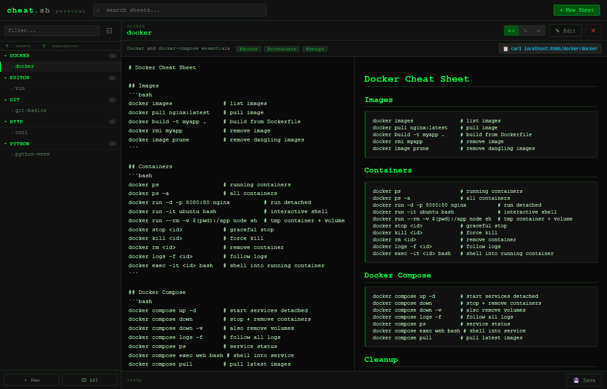

# Personal Cheat Sheet Manager

A FastAPI-powered personal cheat sheet manager that enhances [cheat.sh](https://github.com/chubin/cheat.sh) with a persistent, searchable, editable store of your own snippets — with a **curl-compatible API** so your muscle memory still works.



---

## Features

- **curl-compatible API** — `curl localhost:8505/git/basics` returns plain text, browsers get HTML
- **Dark terminal UI** — black/green monospace aesthetic, feels like home
- **Markdown editor with live preview** — split, edit-only, or preview-only modes
- **Namespace/tag organization** — group sheets by language, tool, or topic
- **Full-text search** — SQLite FTS5 across name, content, tags, and description
- **CRUD via REST API** — create, read, update, delete programmatically
- **Auto-save** — saves 2 seconds after you stop typing
- **Keyboard shortcuts** — `Ctrl+S` save, `Ctrl+K` search
- **Persistent SQLite storage** — no config files, no YAML, just a db file
- **Zero external services** — runs entirely locally

---

## Quick Start

```bash
# From the cheat.sh project root:
cd personal_sheets

# Start the server (uses sherlock venv)
C:\path\to\sherlock\venv\Scripts\uvicorn.exe app:app --host 0.0.0.0 --port 8505

# Or with auto-reload for development
uvicorn personal_sheets.app:app --host 0.0.0.0 --port 8505 --reload
```

Open http://localhost:8505 in your browser.

---

## curl API

The killer feature — fetch any sheet directly from the terminal:

```bash
# Get a sheet (plain text)
curl localhost:8505/git/git-basics
curl localhost:8505/docker/docker
curl localhost:8505/python/python-venv

# Short form (searches default namespace first)
curl localhost:8505/vim

# The server detects curl and returns plain text automatically
# Browsers get a styled HTML preview instead
```

---

## REST API Reference

### List all sheets
```bash
GET /api/sheets
GET /api/sheets?namespace=git
GET /api/sheets?tag=docker
```

### Get single sheet
```bash
GET /api/sheets/{id}
```

### Create sheet
```bash
POST /api/sheets
Content-Type: application/json

{
  "name": "my-commands",
  "namespace": "tools",
  "content": "# My Commands\n\n```bash\nmy-tool --help\n```",
  "tags": ["tools", "cli"],
  "description": "Handy personal commands"
}
```

### Update sheet
```bash
PUT /api/sheets/{id}
Content-Type: application/json

{
  "content": "# Updated content..."
}
```

### Delete sheet
```bash
DELETE /api/sheets/{id}
```

### Search
```bash
GET /api/search?q=docker+compose
```

### Namespaces
```bash
GET /api/namespaces    # returns [{"namespace":"git","count":3}, ...]
```

### Tags
```bash
GET /api/tags          # returns [{"tag":"bash","count":5}, ...]
```

---

## Data Model

Each sheet has:

| Field | Type | Description |
|-------|------|-------------|
| `id` | int | Auto-increment primary key |
| `name` | string | Sheet name (URL-safe, hyphenated) |
| `namespace` | string | Grouping (e.g. `git`, `docker`, `python`) |
| `content` | string | Markdown content |
| `tags` | list[str] | Searchable tags |
| `description` | string | Short description shown in UI |
| `created_at` | ISO datetime | Creation timestamp |
| `updated_at` | ISO datetime | Last update timestamp |

---

## Default Sample Sheets

The app seeds these on first run:

| Sheet | Namespace | Description |
|-------|-----------|-------------|
| `git-basics` | `git` | Common git commands |
| `docker` | `docker` | Docker + docker-compose |
| `curl` | `http` | curl command examples |
| `python-venv` | `python` | Virtual environments + pip |
| `vim` | `editor` | Essential vim keybindings |

---

## Keyboard Shortcuts

| Shortcut | Action |
|----------|--------|
| `Ctrl+S` | Save current sheet |
| `Ctrl+K` | Focus global search |
| `Escape` | Close modals |
| `Tab` | Insert 2 spaces in editor |

---

## Storage

Sheets are stored in `personal_sheets/sheets.db` (SQLite). Back it up with:

```bash
cp personal_sheets/sheets.db personal_sheets/sheets.backup.db
```

---

## Architecture

```
personal_sheets/
├── __init__.py          # version string
├── app.py               # FastAPI app (SQLite CRUD + curl detection)
├── sheets.db            # auto-created on first run
└── static/
    └── index.html       # single-file dark terminal UI
```

The app is a single FastAPI file with:
- SQLite + FTS5 for storage and full-text search
- Pydantic models for request validation
- User-Agent detection to serve plain text to curl, HTML to browsers
- A catch-all route for `/{namespace}/{name}` that handles both curl and browser requests

---

## Screenshots

### Dashboard


---

## Dependencies

Uses packages already available in the sherlock venv:
- `fastapi` — web framework
- `uvicorn` — ASGI server
- `pydantic` — data validation
- `markdown` — server-side markdown rendering (for browser fallback views)
- `sqlite3` — built-in Python standard library

Client-side: [marked.js](https://cdn.jsdelivr.net/npm/marked@9/marked.min.js) (CDN) for live preview.

---

Developed by **[KCCS](https://kccsonline.com)** — [kccsonline.com](https://kccsonline.com)
