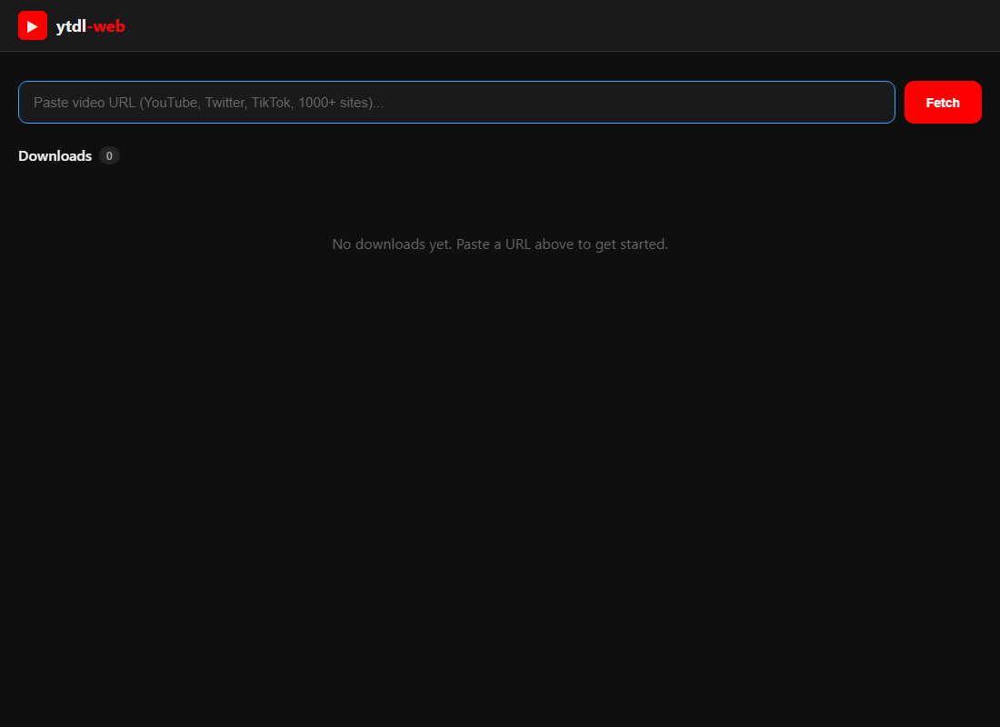

# ytdl-web

Self-hosted web UI for [yt-dlp](https://github.com/yt-dlp/yt-dlp) — the most popular video downloader supporting 1000+ sites.

**Paste URL. Pick quality. Download.** No CLI required.



## Features

- **1000+ sites** — YouTube, Twitter/X, TikTok, Reddit, Twitch, and everything yt-dlp supports
- **Format picker** — Choose quality presets (Best/1080p/720p/Audio Only) or pick exact formats
- **Download queue** — Queue multiple downloads with real-time progress via WebSocket
- **Thumbnail previews** — See video title, uploader, duration before downloading
- **Download history** — SQLite-backed history of all downloads
- **REST API** — Full programmatic access for automation
- **Self-hosted** — Your data stays on your server

## Quick Start

```bash
# Prerequisites: yt-dlp and Python 3.9+
pip install yt-dlp fastapi "uvicorn[standard]"

# Clone and run
git clone https://github.com/pueblokc/ytdl-web.git
cd ytdl-web
python -m uvicorn app:app --host 0.0.0.0 --port 8504
```

Open `http://localhost:8504`

### Docker

```dockerfile
FROM python:3.12-slim
RUN pip install yt-dlp fastapi "uvicorn[standard]"
WORKDIR /app
COPY . .
RUN mkdir -p /downloads
ENV YTDL_DOWNLOAD_DIR=/downloads
EXPOSE 8504
CMD ["uvicorn", "app:app", "--host", "0.0.0.0", "--port", "8504"]
```

## API

| Method | Endpoint | Description |
|--------|----------|-------------|
| `GET` | `/` | Web UI |
| `POST` | `/api/info` | Get video info + formats |
| `POST` | `/api/download` | Start a download |
| `GET` | `/api/downloads` | Download history |
| `GET` | `/api/queue` | Current download queue |
| `DELETE` | `/api/downloads/{id}` | Delete download + file |
| `WS` | `/ws` | Real-time progress updates |

## Environment Variables

| Variable | Default | Description |
|----------|---------|-------------|
| `YTDL_PORT` | `8504` | Server port |
| `YTDL_DOWNLOAD_DIR` | `./downloads` | Where to save files |
| `YTDL_DB_PATH` | `./ytdl_web.db` | SQLite database path |
| `YTDL_PATH` | `yt-dlp` | Path to yt-dlp binary |
| `YTDL_MAX_CONCURRENT` | `3` | Max concurrent downloads |

## License

MIT

---

Developed by **[KCCS](https://kccsonline.com)** — [kccsonline.com](https://kccsonline.com)
